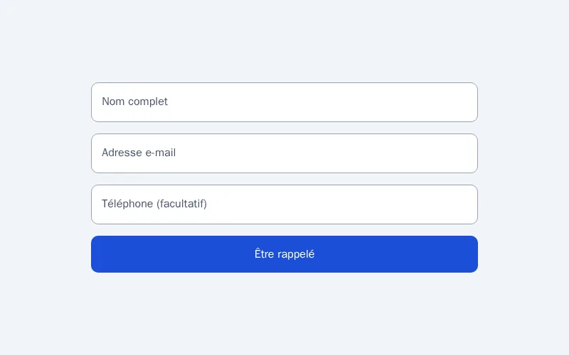

# Champs à libellé flottant

Des champs dont le libellé se loge au-dessus de la saisie, en CSS pur.

**[Voir la démo et la fiche complète sur Forge](https://forgefrance.fr/composants/champs-libelle-flottant?utm_source=github&utm_medium=readme)**

## Formats

| Dossier | Contenu |
|---|---|
| `html-css/` | HTML + CSS natif, sans dépendance (ouvrir `index.html`) |
| `html-tailwind/` | Même composant en classes Tailwind CSS |
| `react/` | Composant React TypeScript (`FloatingLabelFields.tsx`) |

Personnalisation : modifiez les variables CSS en tête de fichier (couleurs, rayons, typographie) ; le thème sombre suit.

La version WordPress (bloc / extension) est téléchargeable gratuitement [sur la fiche Forge](https://forgefrance.fr/composants/champs-libelle-flottant?utm_source=github&utm_medium=readme).
